<h1>TTYphoon</h1>


- [Multimedia Terminal Emulator](#multimedia-terminal-emulator)
- [Terminal Features](#terminal-features)
  - [Output Blocks](#output-blocks)
  - [Structured Text](#structured-text)
  - [Tables](#tables)
  - [Images](#images)
  - [Tmux Support](#tmux-support)
  - [Highlighted Search Results](#highlighted-search-results)
- [IDE](#ide)
  - [Programming Language Tools (LSP)](#programming-language-tools-lsp)
  - [Markdown Viewer](#markdown-viewer)
    - [Executable Notebooks](#executable-notebooks)
    - [Structured Data Documents](#structured-data-documents)
  - [Spreadsheets](#spreadsheets)
  - [Vim-style Editor Keys](#vim-style-editor-keys)
    - [Mode entry](#mode-entry)
    - [Navigation (Normal mode)](#navigation-normal-mode)
    - [Operators (combine with a motion or double for whole line)](#operators-combine-with-a-motion-or-double-for-whole-line)
  - [Swagger](#swagger)
  - [Hex Viewer](#hex-viewer)
  - [Non-Intrusive AI](#non-intrusive-ai)
- [How It Works](#how-it-works)
- [Whats Left To Do](#whats-left-to-do)
  - [Escape Codes](#escape-codes)
    - [VT100](#vt100)
    - [VT52 mode](#vt52-mode)
    - [VT200 mode](#vt200-mode)
    - [Tektronix 4014 mode](#tektronix-4014-mode)
    - [Window management codes](#window-management-codes)
    - [Extended features](#extended-features)
    - [Common application support](#common-application-support)
  - [Application Usability](#application-usability)
- [Supported Platforms](#supported-platforms)
- [Install Guide](#install-guide)
  - [VT Debugging](#vt-debugging)
  - [AI Tracing](#ai-tracing)
  - [AI Web Search](#ai-web-search)
- [How To Support](#how-to-support)

## Multimedia Terminal Emulator

The aim of this project is to provide an easy to use terminal emulator that
supports inlining multimedia widgets.

Currently the project is _very_ alpha.

The idea behind this terminal emulator is that is can be used by any $SHELL,
however hooks will be built into [Murex](https://github.com/lmorg/murex) so
the terminal will be instantly usable even before wider support across other
shells and command line applications is adopted.

At its heart, TTYphoon is a regular terminal emulator. Like Kitty, iTerm2, and
PuTTY (to name a few). But where TTYphoon differs is that it also supports
inlining rich content. Some terminal emulators support inlining images. Others
might also allow videos. But none bar some edge case Electron terminals offer
collapsible trees for JSON printouts. Easy to navigate directory views. Nor any
other interactive elements that we have come to expect on modern user
interfaces.

The few terminal emulators that do attempt to offer this usually fail to be
good, or even just compatible, with all the CLI tools that we've come to depend
on.

TTYphoon aims to do _both well_. Even if you never want for any interactive
widgets, TTYphoon will be a good terminal emulator. And for those who want a
little more GUI in their CLI, TTYphoon will be a great modern user interface.

## Terminal Features

### Output Blocks

Command output is grouped into blocks to make it easier to visually see the
separation between different command output.

Those blocks are coloured too, to help identify whether a command succeeded or
failed.

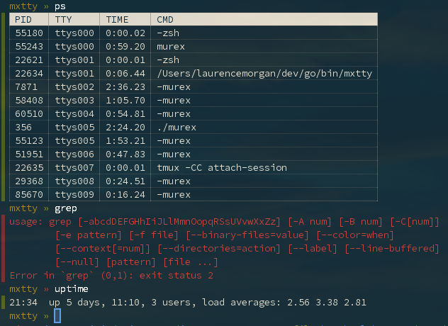

Those blocks can be highlighted by hovering over them

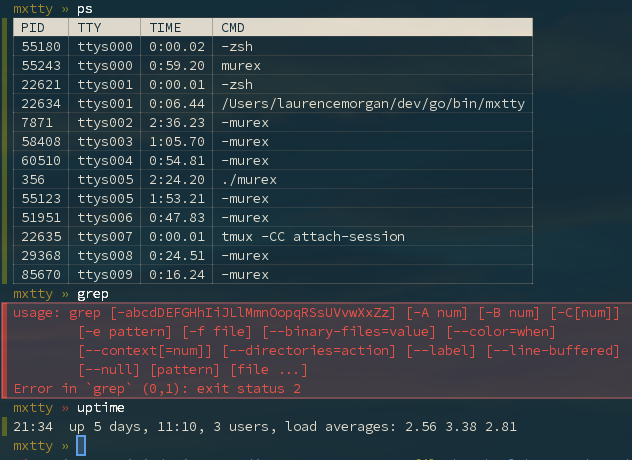

And even collapsed, hidden from view

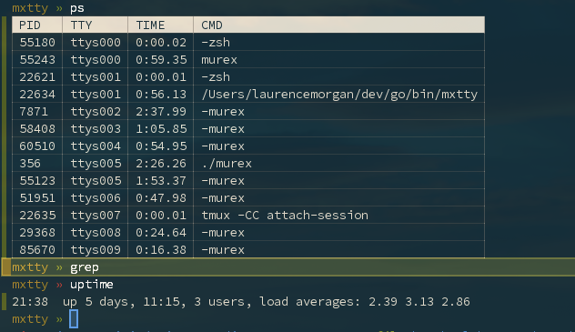

### Structured Text

IDE-like tools for working with structured text, like JSON. Hover over a branch
to highlight its child nodes

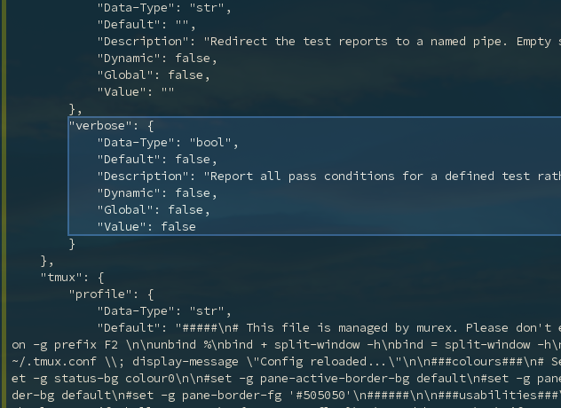

Click to collapse that block of text

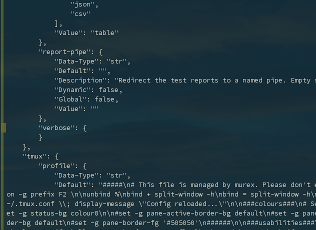

### Tables

Output can be presented as tables. Which can be sorted and even filtered using
SQL. All without having to rerun the commands that generated that output

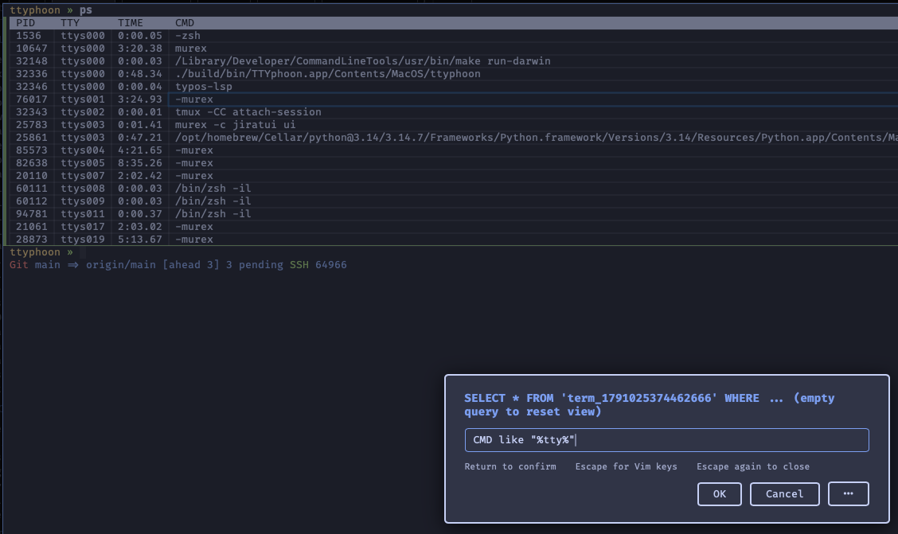

### Images

Support for inlined images, where images are treated as images. for example
they can be copied to clipboard

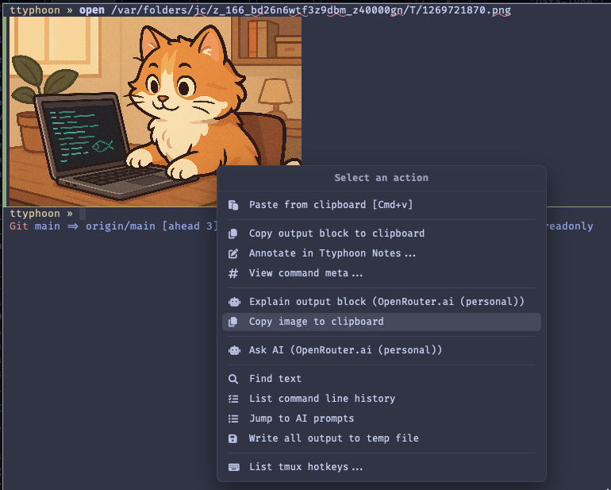

### Tmux Support

Tmux support built in using tmux's control plane. This allows for the power of
tmux but with the easy of use and elegance of being fully integrated into the
terminal emulator

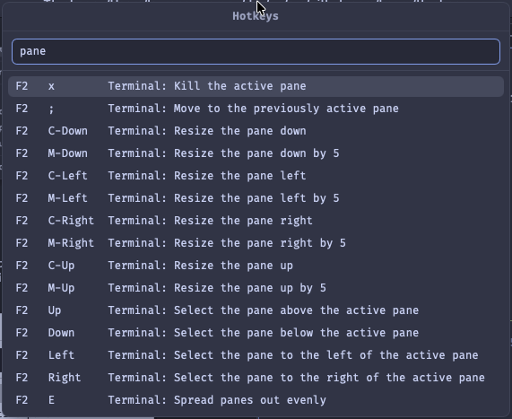

(in this screenshot, tmux's prefix key was rebinded to `F2` in `~/.tmux.conf`)

### Highlighted Search Results

Search terms can be highlighted to quickly find instances of that term

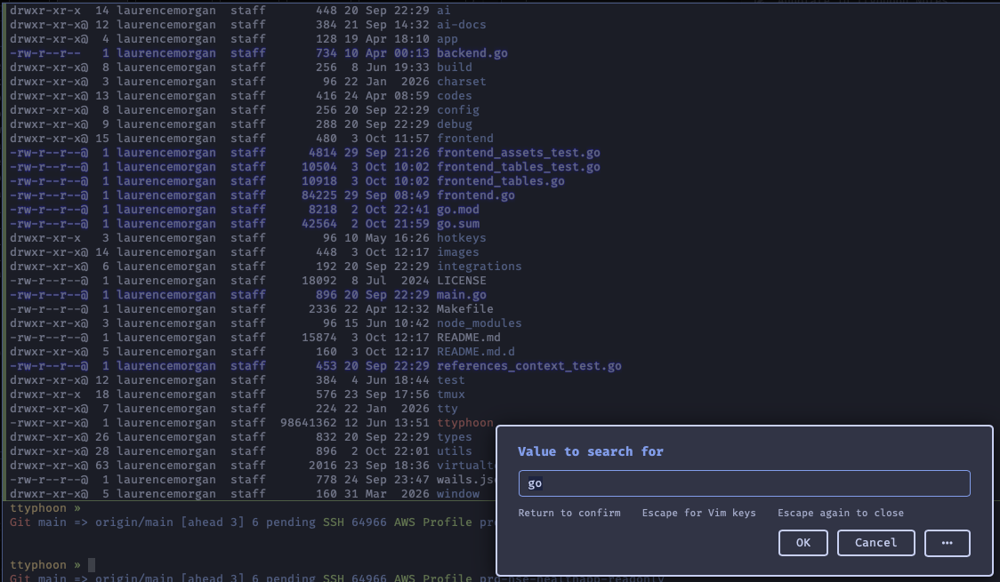

## IDE

### Programming Language Tools (LSP)

Current LSP support includes:

- diagnostics with gutter markers and inline squiggles
- hover and signature help
- completion
- go to definition
- workspace symbol
- inlay hints
- code lens actions
- semantic tokens
- document and range formatting
- code actions / quick fixes
- rename symbol
- document symbols


### Markdown Viewer

You can write notes in markdown alongside your terminal sessions. View readme's, have your documentation with you instead of switching between windows

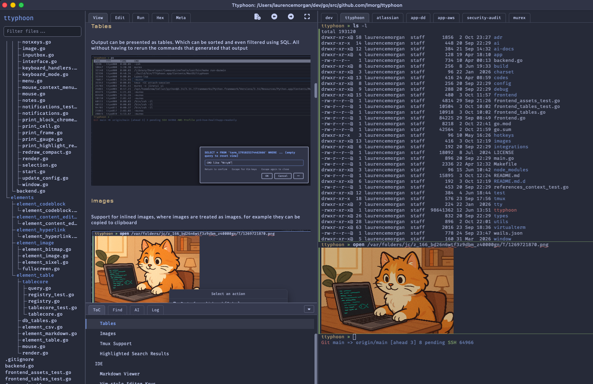

#### Executable Notebooks

You can even execute the code blocks inline. Bringing you the flexibility of Jupyter Notebooks and the power of a full terminal emulator

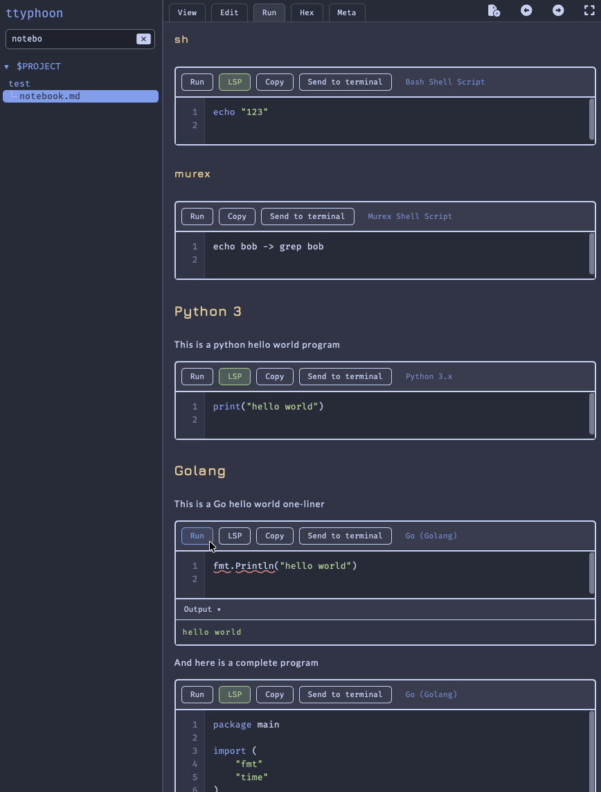

#### Structured Data Documents

Work with JSON, YAML and XML config files more easily

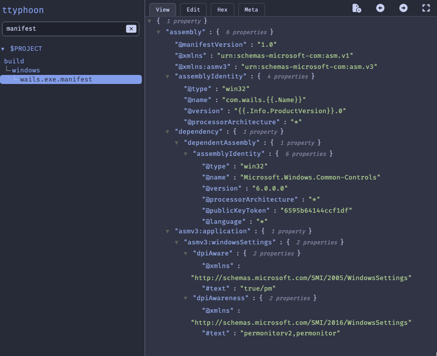

### Spreadsheets

CSV files can be edited directly inside the editor. You can even add algaberic operations


Or use markdown tables if you want to build your own formula functions

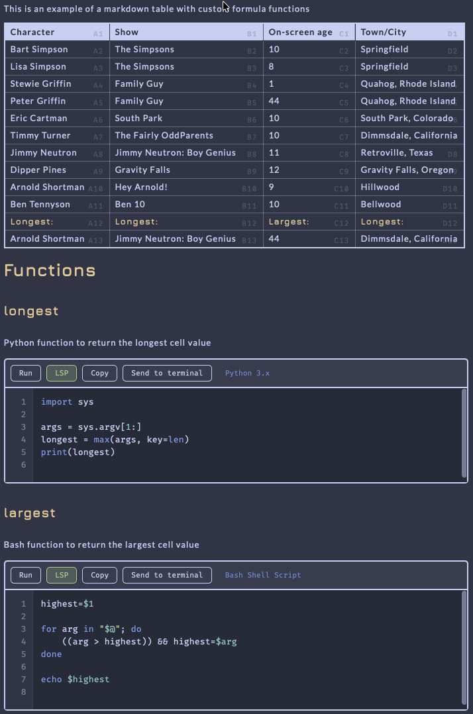

### Vim-style Editor Keys

The Notes editor and Jupyter code blocks support Vim-style keyboard navigation. Press `Escape` to enter Normal mode; a mode indicator appears in the bottom-right corner of the editor. Press `i` (or any insert command) to return to regular editing.

#### Mode entry

| Key | Action |
|-----|--------|
| `Esc` | Enter Normal mode |
| `i` | Insert before cursor |
| `a` | Insert after cursor |
| `I` | Insert at first non-blank of line |
| `A` | Insert at end of line |
| `o` | Open new line below, insert |
| `O` | Open new line above, insert |
| `R` | Enter Replace (overtype) mode — all typed characters overwrite |
| `r{char}` | Replace single character under cursor, stay in Normal |

#### Navigation (Normal mode)

| Key | Action |
|-----|--------|
| `h` / `←` | Left |
| `l` / `→` | Right |
| `j` / `↓` | Down |
| `k` / `↑` | Up |
| `w` | Forward to start of next word |
| `b` | Back to start of previous word |
| `e` | Forward to end of word |
| `0` | Start of line (column 0) |
| `^` | First non-blank character of line |
| `$` / `End` | End of line |
| `gg` | First non-blank of file |
| `G` | Last non-blank of file |
| `{n}G` | Go to line *n* |
| `%` | Jump to matching bracket (`(` `)` `[` `]` `{` `}`) |

#### Operators (combine with a motion or double for whole line)

| Key | Action |
|-----|--------|
| `d{motion}` | Delete range covered by motion |
| `dd` | Delete current line |
| `D` | Delete to end of line |
| `c{motion}` | Delete range and enter Insert |
| `cc` | Change current line |
| `C` | Change to end of line |
| `y{motion}` | Yank (copy) range into internal register |
| `yy` / `Y` | Yank current line |
| `x` | Delete character under cursor |
| `X` | Delete character before cursor |
| `p` | Paste yanked text after cursor |
| `P` | Paste yanked text before cursor |
| `u` | Undo |

All operators and motions accept a **count prefix** (e.g. `3w`, `5dd`, `10j`).

### Swagger

Native support for Swagger and OpenAPI files. So you don't need to be a `curl` expert all of the time


### Hex Viewer

Sometimes you just need to view the raw bytes of a file

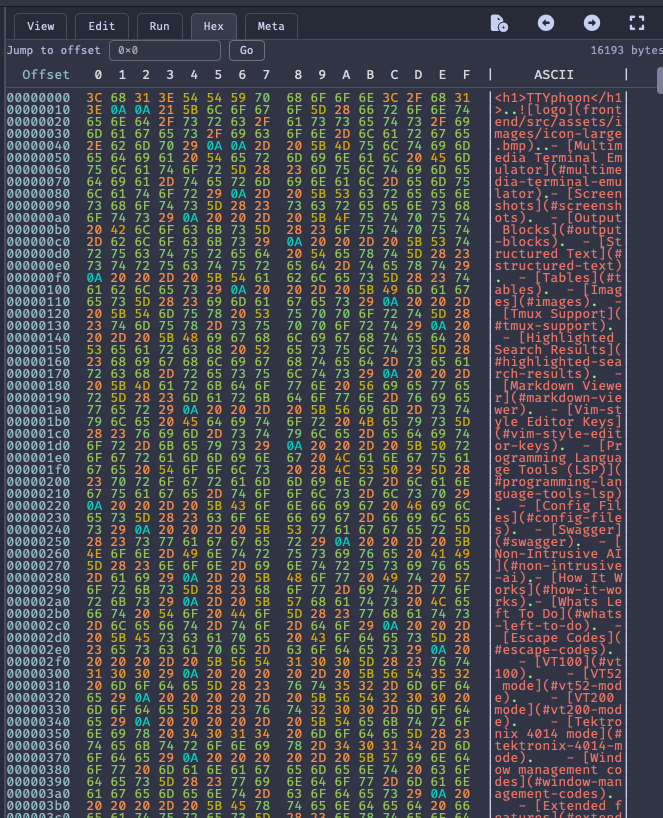

### Non-Intrusive AI

AI is crammed everywhere - even where you don't want it. TTYphoon integrates AI but does so non-intrusively. It's there if you need to quickly debug something. Or want to quickly generate code. Or not there if you prefer. It isn't a clown constantly fighting you for your attention.


## How It Works

TTYphoon native code in the backend to provide fast computation and then pushes the last mile rendering to webkit.

This ensures that the terminal reuses performant existing technologies which have already been fine-tuned by larger organisations like Apple, Microsoft and Google. But without the _massive_ overhead of running Electron or other Chrome-based solutions.

The multimedia and interactive components will be passed from the controlling
terminal applications via ANSI escape sequences. Before groan, yes I agree that
in-band escape sequences are a lousy way of encoding meta-information. However
to succeed at being a good terminal emulator, it needs to support some historic
design decisions no matter how archaic they might seem today. This allows
TTYphoon to work with existing terminal applications _and_ for third parties to
easily add support for their applications to render rich content in TTYphoon
without breaking compatibility for legacy terminal emulators.

## Whats Left To Do

In short, _a lot_!! Some of what has been detailed above is still in a _very_
alpha state. And while there is lots of error handling and unit tests, test
coverage is still pretty low.

Below is a high level TODO list of features and compatibility. If an item is
ticked but not working as expected, then please raise an issue in Github.

### Escape Codes

#### VT100

- C1 codes
  - [x] common: can run most CLI applications
  - [x] broad: can run older or more CLI applications
  - [ ] complete: xterm compatible
- CSI codes
  - [x] common: can run most CLI applications
  - [x] broad: can run older or more complicated CLI applications
  - [ ] complete: xterm compatible
- SGR codes
  - [x] common: can run most CLI applications
  - [x] broad: can run older or more complicated CLI applications
  - [ ] complete: xterm compatible
  - [ ] extended underline: kitty compatible
- OSC codes
  - [x] common: can run most CLI applications
  - [x] broad: can run older or more complicated CLI applications
  - [ ] complete: xterm compatible
- DCS codes
  - [ ] common: can run most CLI applications
  - [ ] broad: can run older or more complicated CLI applications
  - [ ] complete: xterm compatible
- [x] Alt character sets
- [x] Wide characters
  - [ ] vt100 (ASCII characters)
  - [x] Unicode (eg logograph-centric languages and emoticons)
- Keyboard
  - [x] Ctrl modifiers
  - [x] Alt modifiers
  - [x] Shift modifiers
  - [x] special keys (eg function keys, number pad, etc)
    - [ ] glitch free (some bugs still exist)
  - [x] tmux support for modifiers
- Mouse tracking
  - [x] common: can run most CLI applications
  - [x] broad: can run older or more complicated CLI applications
  - [ ] complete: xterm compatible

#### VT52 mode

- [ ] cursor movements
- [ ] special modes

#### VT200 mode

Some compatibility already exists. Detailed breakdown coming...

#### Tektronix 4014 mode

- [ ] graphics plotting
- [ ] text rendering

#### Window management codes

eg `xterm` and similar terminal emulators

- [x] titlebar can be changed
- [ ] ~~window can be moved and resized (WILL NOT IMPLEMENT)~~
- [ ] window can be minimized and restored

#### Extended features

- [ ] Hyperlink support
  - [x] Auto-hyperlink files
  - [x] Auto-hyperlink URLs
  - [ ] ANSI escape sequence supported (rejected because of safety concerns)
- [ ] Bracketed paste mode
- [x] Inlining images
  - [x] TTYphoon codes
  - [ ] iterm2 compatible
  - [ ] Kitty compatible
  - [x] sixel graphics
  - [ ] ReGIS graphics
- [x] Code folding
- [x] Table sorting
  - [x] alpha: available but expect changes to the API
  - [x] stable: available to use in Murex

#### Common application support

- [x] Supports `tmux`
  - [x] usable from CLI
  - [x] glitch-free from CLI
  - [x] tmux control mode supported
- [x] Supports `vim`
  - [x] usable
  - [x] glitch-free
- [x] Supports `murex`
  - [x] usable
  - [x] glitch-free

### Application Usability

- [x] Terminal can be resized
- [x] Scrollback history
  - [x] usability hints added
- [x] discoverability hints added
- [x] Typeface can be changed
- [x] Colour scheme can be changed
  - [x] supports iTerm2 colour themes
- [ ] Bell can be changed
- [x] Default term size can be changed
- [x] Default command / shell can be changed

## Supported Platforms

Support for the following platforms is planned:

- [x] Linux
  - [x] tested on Arch
  - [ ] tested on Ubuntu
  - [ ] tested on Rocky
- [ ] BSD
  - [ ] tested on FreeBSD
  - [ ] tested on NetBSD
  - [ ] tested on OpenBSD
  - [ ] tested on DragonflyBSD
- [x] macOS
  - [ ] tested on 12.x, Monterey
  - [ ] tested on 13.x, Ventura
  - [x] tested on 14.x, Sonoma
  - [x] tested on 15.x, Sequoia
- [ ] Windows
  - [ ] PTY support implemented
  - [ ] tested on Windows 10
  - [ ] tested on Windows 11

## Install Guide

Currently TTYphoon can only be compiled from source.

To do so you will need the following installed:
- C compiler (eg GNU C)
- Go compiler
- [wails](https://wails.io/) command line tool
- GNU Make (available by default on POSIX systems)

Aside from that, it's as easy as running `make build` from the git repository
root directory.

### VT Debugging

The terminal emulator functions can provide verbose logging for debugging. To
enable this, build with `-tags debug` flag. Please note that this will add a
lot of noise to the stdout of the terminal used to launch TTYphoon.

### AI Tracing

The AI features, prompts sent to LLMs and messages between MCP tools can be
traced for debugging. To enable this, build with `-tags trace`. Trace messages
are sent to the stdout of the terminal used to launch TTYphoon.

### AI Web Search

| Environment Variable | Default | Meaning |
| --- | --- | --- |
| `TTYPHOON_WEB_SEARCH_PROVIDER` | `duckduckgo` | Select `duckduckgo` or `searxng`. Unset or empty preserves DuckDuckGo. |
| `TTYPHOON_SEARXNG_URL` | Unset | Required for `searxng`: an absolute HTTP(S) instance URL, optionally with a path prefix or `/search`. Credentials, query parameters, and fragments are not allowed. |
| `TTYPHOON_SEARXNG_HEADERS` | No extra headers | Optional JSON object of header names to string values, up to 32 KiB. Supports private-instance authentication; requires HTTPS except on loopback. Invalid or reserved headers are rejected. |
| `TTYPHOON_SEARXNG_MAX_CONCURRENT` | `2` | Integer from `1` to `16`. Shared limit for active search and discovery requests to the same instance across agents. |

These are application launch-environment settings, not active-pane environment
settings. Set them before launching TTYphoon and restart after changing them;
exporting them inside an already-running terminal pane does not reconfigure the
application. The three `TTYPHOON_SEARXNG_*` settings are ignored when the provider
is DuckDuckGo.

The existing web-search tool defaults to DuckDuckGo's Instant Answer API. To
use a SearXNG instance instead, set these variables in the environment that
launches TTYphoon, then restart the application:

```sh
export TTYPHOON_WEB_SEARCH_PROVIDER=searxng
export TTYPHOON_SEARXNG_URL=http://127.0.0.1:8080
```

Private instances can use authentication headers configured in the launch
environment, never in AI tool arguments:

```sh
export TTYPHOON_SEARXNG_HEADERS='{"Authorization":"Bearer REPLACE_WITH_TOKEN"}'
export TTYPHOON_SEARXNG_MAX_CONCURRENT=2
```

The headers variable is a JSON object; custom authentication headers such as
`X-API-Key`, Basic authorization, and cookies are also supported. Keep real
values in a private launcher environment or secret manager, not source control
or tool prompts. Credential-bearing URLs and reserved routing/framing headers
are rejected. Authentication requires HTTPS except for loopback instances.
Configured credential values are redacted from tool output and errors, and are
never applied to DuckDuckGo or forwarded through redirects. Changing these
settings requires an application restart.

SearXNG search and discovery share a per-instance concurrency limit across
agents: two requests by default, configurable from 1 to 16. The slot remains
held until the response body is closed; queued requests can be cancelled. HTTP
429 and 503 responses start a shared cooldown using `Retry-After` seconds or an
HTTP date. A missing or invalid value uses 30 seconds. During cooldown, new
outbound requests fail promptly with the remaining delay and UTC retry time;
they are not automatically retried or sent to another provider. Existing
in-flight requests are not aborted, and cached discovery remains usable.

The URL may include an instance path prefix or end in `/search`. The instance
must permit JSON responses in its `settings.yml`:

```yaml
search:
  formats:
    - html
    - json
```

Many public instances disable JSON or rate-limit automated requests; a private
instance is preferable. Searches return titles, URLs, and plain-text snippets,
not complete pages. The existing `scrapeWebPage` tool can read a selected page.
For compatibility with saved tool permissions, the tool keeps its existing
`searchDuckDuckGo` identifier even when its description and backend use SearXNG.

SearXNG accepts optional categories, engines, language, and time-range filters,
plus bounded pagination and result limits:

```json
{"query":"Go release notes","categories":["general"],"language":"en","time_range":"month","page":2,"limit":5}
```

`page` defaults to 1 and accepts 1-10; `limit` defaults to 10 and accepts 1-50.
The limit applies to unique URL results returned to the AI, not an upstream
engine's page size. Additional pages are never fetched automatically. DuckDuckGo
also accepts `limit`, but its Instant Answer API does not support later pages.

Results preserve publication dates, publishers/source labels, and contributing
engines when supplied. Missing dates are reported as unknown. Known tracking
parameters (`utm_*`, `fbclid`, `gclid`, `msclkid`) are removed for URL
deduplication; meaningful query parameters and fragments are retained. Duplicate
URLs merge engine provenance, not independent corroboration.

SearXNG may also return suggested queries, corrections, direct answers, and
source-linked infobox summaries. These are bounded supplements, not automatic
follow-up actions. Answers lacking attribution say so; infoboxes without a valid
source URL are omitted. Search output is capped at 64 KiB, with a truncation
notice when necessary. Image metadata and image downloading are not included.

To discover your instance's engine names, shortcuts, categories, and support
for paging, language filters, time ranges, and safe search, call the same tool
without a search query:

```json
{"action":"discover"}
```

Discovery uses the instance's `/config` endpoint. Results are cached for ten
minutes per search-tool instance; use `{"action":"discover","refresh":true}`
to reload them. Engine `enabled` means enabled by default, not current engine
health. Missing capability flags remain unknown. Discovery does not send a
query to upstream search engines, and an inaccessible `/config` endpoint does
not prevent normal searches. Normal searches do not fetch discovery metadata
automatically. Large responses report their full engine count and whether the
returned metadata was truncated.

When fresh discovery metadata is cached, unknown engine/category names are
rejected with a refresh hint. Known engine shortcuts are resolved to full names.
Truncated caches cannot definitively reject an unlisted name, and missing or
expired discovery never blocks searching. Advertised paging, language,
time-range, default-enablement, and category mismatches produce advisories rather
than silently changing the request. This validation does not fetch `/config`.

Use category and engine names supported by your instance. Time ranges are
`day`, `month`, or `year`; support varies by upstream engine. SearXNG errors do
not silently fall back to another provider, and search redirects are not
followed. To restore DuckDuckGo, unset `TTYPHOON_WEB_SEARCH_PROVIDER` or set it
to `duckduckgo`. These optional filters require the SearXNG backend.

## How To Support

Regardless of your time and skill set, there are multiple ways you can support
this project:

- **Contributing code**: This could be bug fixes, new features, or even just
  correcting any typos.

- **Testing**: There is a plethora of different software that needs to run
  inside a terminal emulator and a multitude of distinct platforms that this
  could run on. Any support testing TTYphoon would be greatly appreciated.

- **Documentation**: This is possibly the hardest part of any project to get
  right. Eventually documentation for this will follow the same structure as
  [Murex Rocks](https://murex.rocks) (albeit its own website) however, for now,
  any documentation written in markdown is better than none.

- **Architecture discussions**: I'm always open to discussing code theory. And
  if it results in building a better terminal emulator, then that is a
  worthwhile discussion to have.

- **Porting escape codes to other applications**: Currently [Murex](https://github.com/lmorg/murex)
  is the pioneer for supporting TTYphoon-specific ANSI escape codes. However it
  would be good to see some of these extensions expanded out further. Maybe
  even to a point where this terminal emulator isn't required any more than a
  place to beta test future proposed escape sequences.
